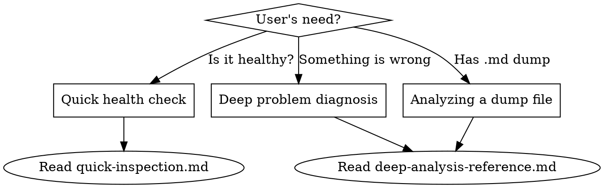

# OpenSearch / Elasticsearch Diagnostics

Toolkit for diagnosing OpenSearch and Elasticsearch cluster issues. Works with both OpenSearch (AWS-managed or self-hosted) and Elasticsearch clusters.

## Operating Modes

**Interactive mode** (preferred): Run `curl` commands via Bash, adapt based on findings. Start with quick inspection, drill into problems.

**Offline mode**: User runs `gather-stats.sh` to produce a single `.md` dump file. Read and analyze the file.

## Connection

```bash
# Defaults
HOST="${HOST:-localhost}" PORT="${PORT:-9200}" PROTOCOL="${PROTOCOL:-http}"

# With auth
curl -u "$ES_USER:$ES_PASS" "$PROTOCOL://$HOST:$PORT/..."

# HTTPS with custom CA
curl --cacert /path/to/ca.pem "https://$HOST:$PORT/..."
```

Ask the user for connection details before running any commands.

## Which Sub-Document to Use



- **"Is my cluster okay?"** → Read `quick-inspection.md` — 5 commands, fast triage
- **"Something is wrong / slow / red"** → Read `deep-analysis-reference.md` — full diagnostic
- **User provides a stats dump** → Read `deep-analysis-reference.md` — use it to interpret the dump

## Offline Gathering

If the user needs to gather stats without Claude's direct access, point them to `gather-stats.sh` in this skill directory. It produces a single markdown file containing all diagnostic endpoints.

```bash
./gather-stats.sh <index-name> [host] [port]
# Or with auth:
ES_USER=admin ES_PASS=secret PROTOCOL=https ./gather-stats.sh my_index es.example.com 9200
```
